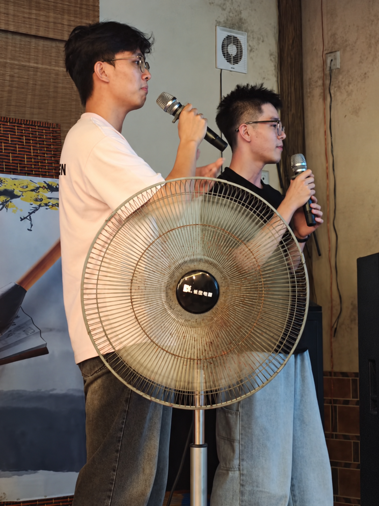
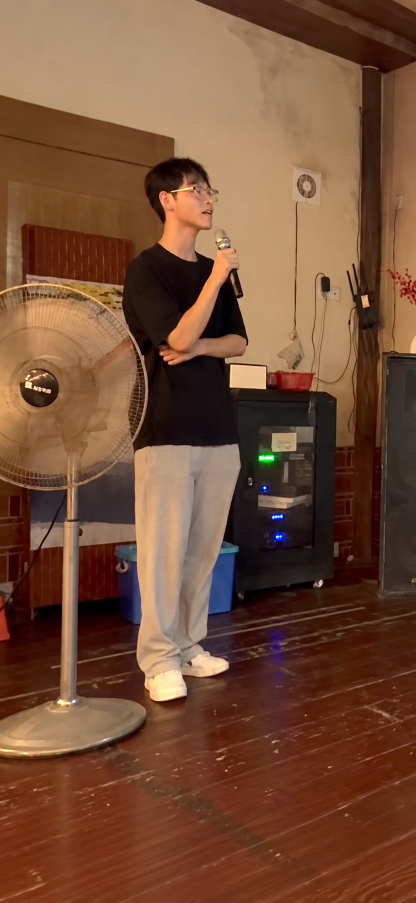
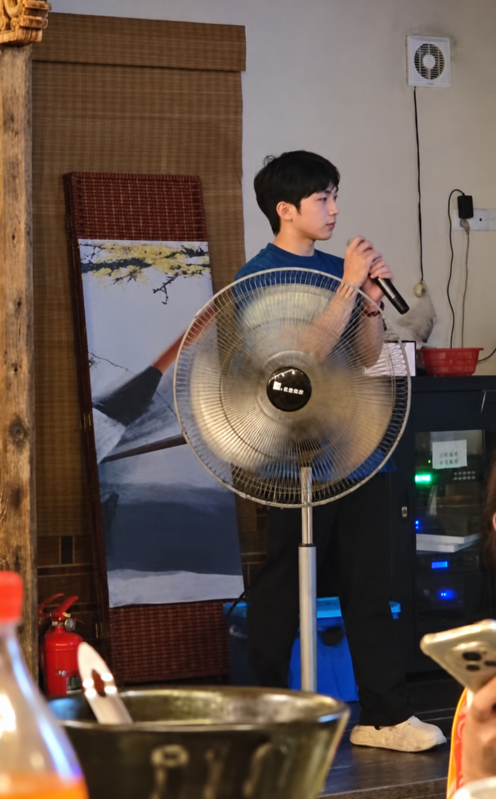
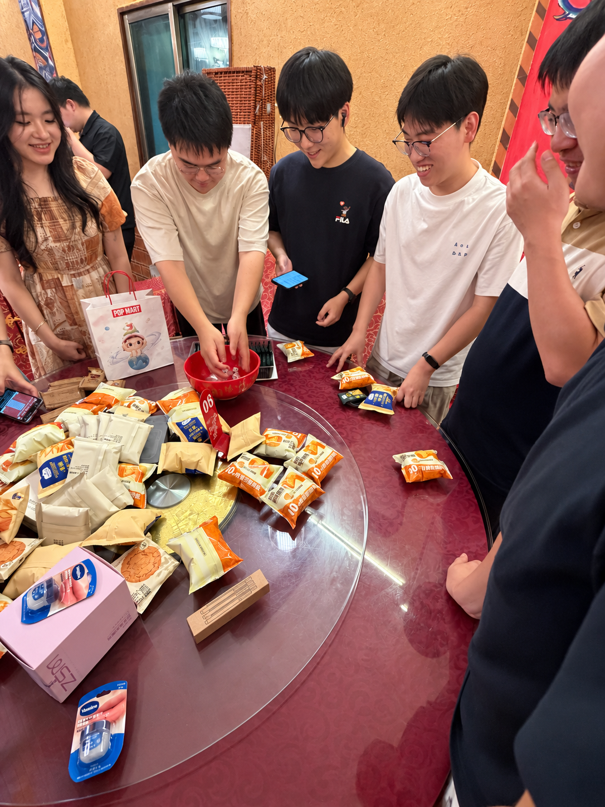

&emsp;&emsp;近日，课题组组织师生开展闽南中秋迎新团建活动，共庆中秋佳节，欢迎新同学加入课题组。大家欢聚一堂，在共享美食、欣赏献唱和参与传统博饼活动的过程中增进交流，感受闽南中秋民俗的独特魅力。

<!--more-->
- - -

&emsp;&emsp;活动在温馨热闹的聚餐中拉开帷幕。师生们围坐在一起，一边品尝美食，一边畅谈学习与生活。新老同学在轻松愉快的交流中逐渐熟悉，让初入课题组的新成员感受到集体的温暖。

&emsp;&emsp;席间，同学们踊跃献唱，用歌声为团聚增添欢乐。独唱与合唱轮番登场，现场不时响起掌声与喝彩声。歌声与笑声交织，为聚餐增添了轻松愉快的氛围，也展现了课题组成员朝气蓬勃的精神风貌。

  <figure style="margin: 0;">
    
    <figcaption>图1　同学合唱</figcaption>
  </figure>
  <figure style="margin: 0;">
    
    <figcaption>图2　同学献唱</figcaption>
  </figure>
  <figure style="margin: 0;">
    
    <figcaption>图3　同学献唱</figcaption>
  </figure>

&emsp;&emsp;聚餐结束后，充满闽南特色的中秋博饼活动将现场气氛推向高潮。大家围聚桌边，轮流掷骰，在清脆的骰子碰撞声中期待好运降临。小小的骰子牵动着大家的目光，惊喜的欢呼与阵阵笑声此起彼伏。同学们在互动中感受传统民俗的乐趣，也为这次中秋相聚留下了难忘的共同回忆。

&emsp;&emsp;此次中秋迎新团建活动为课题组师生提供了放松身心、增进了解的机会，也帮助新同学更好地融入集体。以团圆凝聚情谊，以迎新开启新程，课题组成员将带着这份温暖与默契，在今后的学习和科研中相互支持、携手前行。
