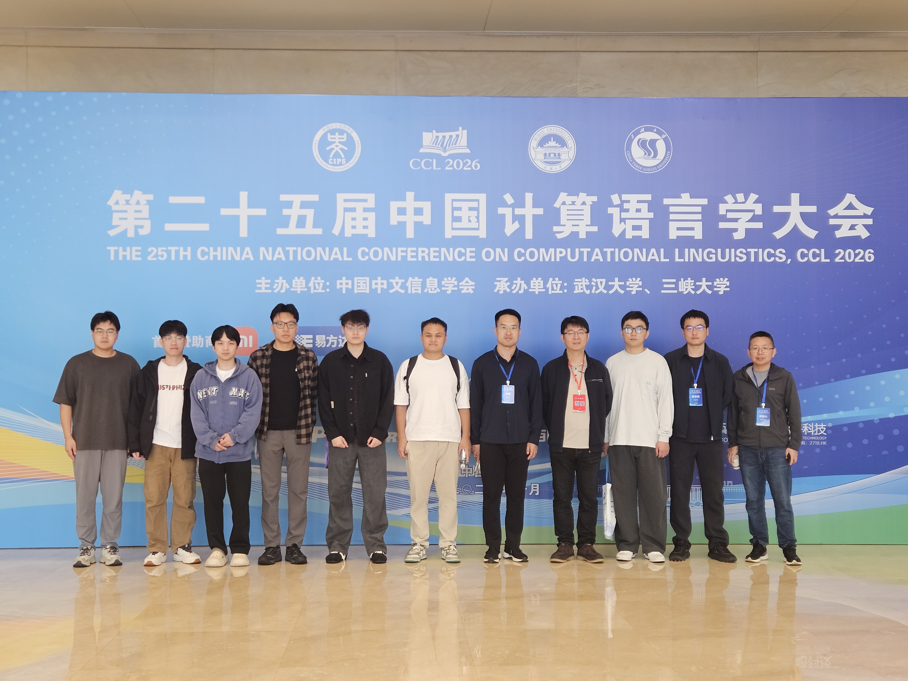

&emsp;&emsp;2026年10月15日至18日，第二十五届中国计算语言学大会（CCL 2026）在湖北省宜昌市举行。本次大会由中国中文信息学会计算语言学专业委员会主办，武汉大学、三峡大学承办，汇聚自然语言处理领域的专家学者与产业界代表，共同探讨计算语言学与自然语言处理的前沿进展。厦门大学语言智能技术课题组（DeepLIT课题组）的苏劲松教授、李辉博士及六位同学参加了此次学术盛会。

<!--more-->
- - -

&emsp;&emsp;中国计算语言学大会是中国中文信息学会的旗舰会议，为自然语言处理领域的学术交流与成果展示提供了重要平台。本届大会设置特邀报告、前沿技术讲习班、专题论坛、学术论文报告及海报展示等环节，议题涵盖多模态大模型、大模型智能体、端侧大模型、世界模型等前沿方向。课题组成员认真聆听专家报告，积极参与学术讨论，并结合自身研究与参会学者交流，进一步深化了对相关领域研究进展与发展趋势的理解。

&emsp;&emsp;此次参会为课题组师生与国内同行交流学习提供了宝贵机会。通过参与各项学术活动，课题组成员拓展了学术视野，收获了新的研究思路与科研建议，为后续研究工作的深入推进与未来科研方向的规划提供了有益参考。
