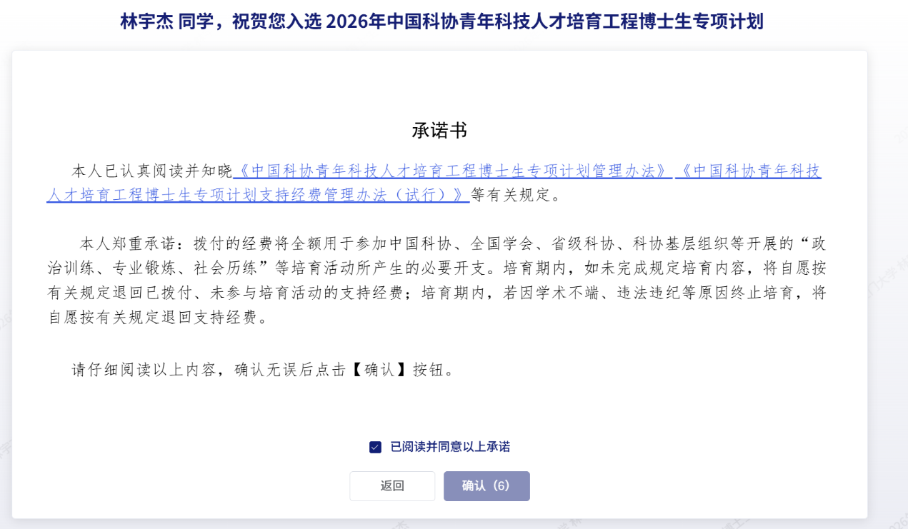

&emsp;&emsp;中国科协青年科技人才培育工程博士生专项计划旨在加强青年科技人才培养，支持博士生拓展学术视野、提升科研创新能力，助力青年科技人才成长成才。实验室林宇杰同学成功入选2026年中国科协青年科技人才培育工程博士生专项计划。此次入选，是对该同学科研潜力与综合素养的肯定，也体现了实验室在青年科技人才培养和科研创新方面的积极成效。
<!--more-->

&emsp;&emsp;一直以来，实验室高度重视青年科研人才培养，积极营造潜心科研、勇于创新、追求卓越的学术氛围，鼓励学生立足学科前沿、面向科研需求，在探索未知中锤炼本领、提升能力。林宇杰同学主要从事可信人工智能与机器学习研究，研究聚焦于算法公平性、分布外泛化以及语言模型的偏见消除与知识遗忘等方向。希望同学以此为契机，进一步拓展学术视野、夯实科研基础、提升创新能力，积极参与学术交流与科技实践，努力产出高水平科研成果。
