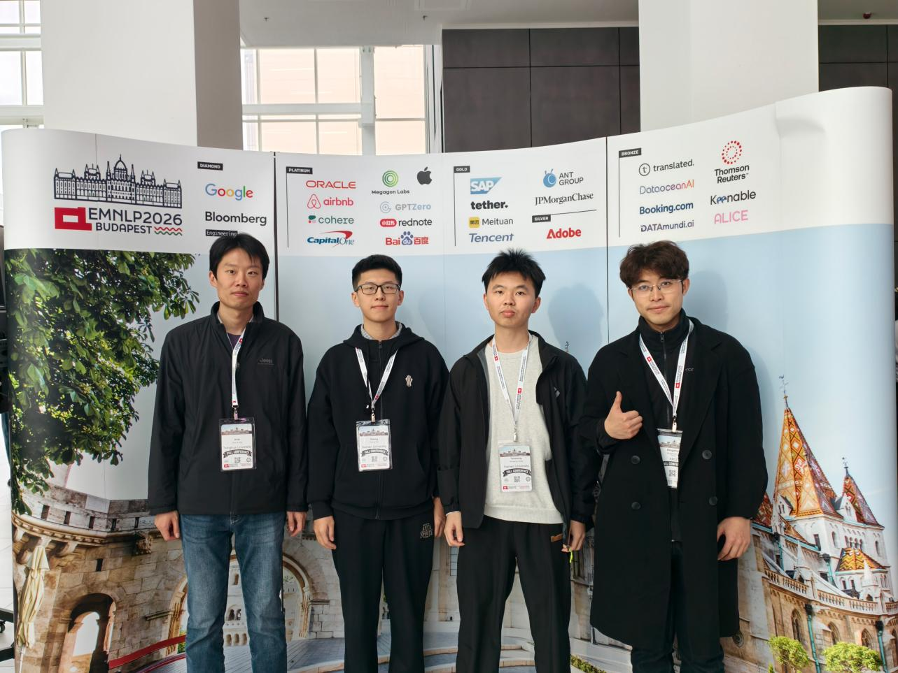

&emsp;&emsp;2026年10月24日至29日，自然语言处理实证方法会议（EMNLP 2026）在匈牙利布达佩斯举行。EMNLP是国际计算语言学协会（Association for Computational Linguistics, ACL）下属特殊兴趣小组SIGDAT举办的学术会议，是自然语言处理与计算语言学领域的国际顶级学术会议之一。本届会议共收到17669篇投稿，其中2719篇被主会录用、2533篇被Findings录用，主会录用率为15.4%，Findings录用率为14.3%。本课题组的姚一鸣、刘冰帅、王耀祥、王安特同学参加了此次学术盛会。

<!--more-->
- - -

&emsp;&emsp;本届大会以"LLM时代NLP研究的使命"为主题。三场主旨报告分别探讨了自然语言处理领域科学与工程双重目标的失衡与重建、开放研究在大模型时代的价值与方法论，以及面向全球语言多样性的"从世界出发"的研究范式；"New Missions in NLP Research"圆桌论坛则围绕人工智能安全与对齐、评测基准的有效性、人工智能辅助科研中的人机分工，以及审稿与发表制度改革等议题展开深入讨论。课题组成员认真聆听特邀报告，积极参与学术讨论，并结合自身研究与参会学者交流，进一步深化了对相关领域研究进展与发展趋势的理解。

&emsp;&emsp;在论文展示环节，姚一鸣同学在主会口头报告环节介绍了课题组在长语音大模型KV缓存压缩方面的最新研究工作；刘冰帅、王耀祥、王安特同学分别就可验证奖励强化学习的采样效率、混合专家模型的弹性推理、对话系统主动思考机制进行了海报展示。

&emsp;&emsp;此次参会为课题组同学与国际同行面对面交流提供了宝贵机会。通过参与各项学术活动，课题组成员拓展了学术视野，收获了关于研究选题与成果表达的多方面建议，为后续研究工作的深入推进与未来科研方向的规划提供了有益参考。
