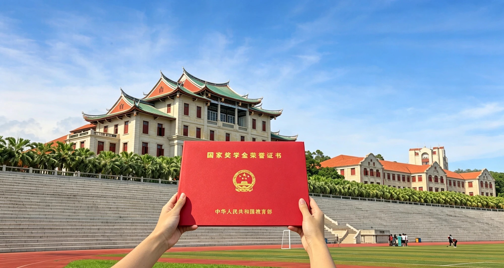

&emsp;&emsp;近日，厦门大学2026年研究生国家奖学金、本科生国家奖学金评审结果揭晓。本课题组2025级硕士研究生吴传杰同学荣获研究生国家奖学金，本科生鲍仁旭、龚志鹏同学荣获本科生国家奖学金。

<!--more-->
- - -

&emsp;&emsp;国家奖学金由中央政府出资设立，用于奖励普通高等学校中特别优秀的全日制学生，是当前高校学生能够获得的荣誉等级最高的国家级奖学金之一。其评审标准涵盖学业成绩、科研能力、综合素质等多个方面，名额有限、竞争激烈。此次课题组三位同学同时获评，既是对他们勤勉向学、潜心钻研的充分肯定，也是课题组人才培养成效的生动体现。

&emsp;&emsp;吴传杰同学为课题组2025级硕士研究生，主要研究方向为基于图的检索增强生成与大模型智能体。入学以来，他在导师指导下围绕图检索增强生成开展研究，以共同第一作者身份在ICLR 2026、KDD 2026等CCF-A类国际会议发表论文，展现出扎实的专业基础与良好的科研创新能力。

&emsp;&emsp;鲍仁旭、龚志鹏两位本科生同学在课题组参与科研训练，在课程学习与科研实践中勤奋刻苦、积极进取，展现出良好的学习能力与科研潜质。此次获奖，是对他们本科阶段优异表现的肯定，也为他们今后的学习与研究增添了新的动力。

&emsp;&emsp;课题组始终坚持立德树人根本任务，注重学生科研能力与综合素质的协同培养，鼓励同学们面向国家需求与国际前沿开展研究。此次三位同学荣获国家奖学金，将进一步激励课题组全体同学以先进为榜样，勤学善思、勇于创新，在科研道路上不断取得新的成绩。

&emsp;&emsp;祝贺吴传杰、鲍仁旭、龚志鹏同学！希望他们珍惜荣誉、再接再厉，在今后的学习与科研中保持初心、笃行不怠，以更加扎实的成果回报师长与学校的培养。
