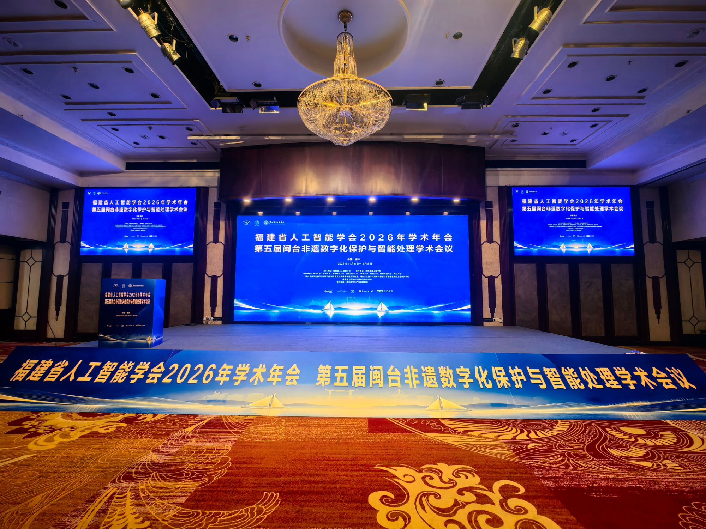

&emsp;&emsp;2026年11月6日至8日，福建省人工智能学会2026年学术年会暨第五届闽台非遗数字化保护与智能处理学术会议在福建省泉州市举行。本次会议由福建省人工智能学会主办、泉州信息工程学院承办，汇聚了来自高校、科研院所及企业界的专家学者，围绕人工智能前沿技术、大模型与智能体、闽台非遗数字化保护与智能处理等议题展开深入交流。课题组教授苏劲松及鲍仁旭、龚志鹏、侯爵和刘佳辉同学参加了此次学术会议。

<!--more-->
- - -

&emsp;&emsp;本次会议设置大会报告、大语言模型与智能体论坛、闽台非遗数字化保护与智能处理论坛等环节，内容涵盖传统文化多模态人工智能、大模型智能体可信推理、文物三维重建及数字化遗产教育等研究方向。在以"多模态大模型如何赋能闽台非遗的传承与创新"为主题的圆桌对话中，苏劲松教授作为嘉宾参与讨论，与其他专家学者围绕非遗数字资源的采集建档、智能处理与活化利用等问题深入交流，共同探讨人工智能技术与非遗保护传承深度融合的创新路径。

&emsp;&emsp;此次会议为课题组与相关领域专家学者开展学术交流提供了良好平台，进一步拓展了人工智能与文化遗产数字化保护交叉研究的思路，也为课题组后续开展大模型技术研究及相关应用探索提供了有益参考。
